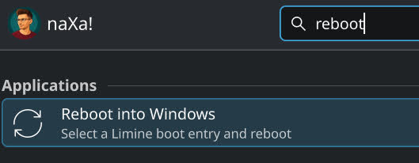
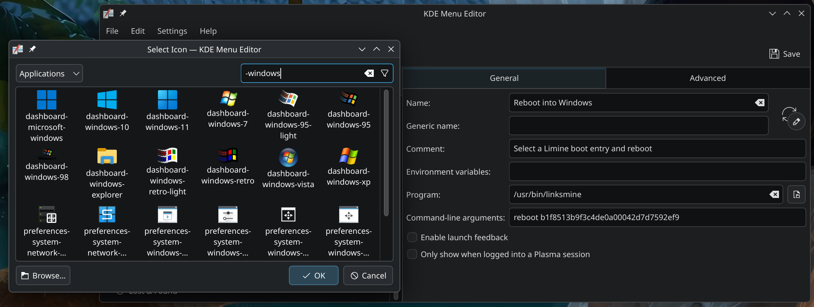

# Linksmine

**Linksmine — Boot entries, one click away.**

Linksmine is a CLI setup wizard that turns an existing Limine boot entry into a KDE application-menu shortcut. Imagine one-click rebooting into Windows from Linux.

Choose an entry, edit the shortcut name, and let Linksmine handle selection and restart. It does not install or replace your bootloader.

## Requirements

- Arch Linux or an Arch-based distribution, such as CachyOS, on x86_64.
- KDE Plasma and a UEFI installation of Limine.
- `remember_last_entry: yes` enabled in your active Limine configuration.
- An existing string-based `LimineLastBootedEntry` EFI variable.

Boot an entry through Limine after enabling `remember_last_entry` if no remembered-entry variable exists yet.

## Install

Build and install a pacman package from the source repository:

```sh
git clone https://github.com/naXa777/linksmine.git
cd linksmine
makepkg -si
```

Building requires the Arch `base-devel` package group. Runtime dependencies are installed by `makepkg -s`.

## Create a shortcut

Run as your normal desktop user:

```sh
linksmine
```

Use the arrow keys to choose an entry. Edit the prefilled shortcut name, then confirm:

```text
Linksmine — Boot entries, one click away.

Select a Limine entry:
  > Windows
    CachyOS/linux-cachyos

Application-menu shortcut name:
> Reboot into Windows

Create shortcut “Reboot into Windows”? [Y/n]
```

Administrator authorization is requested during setup. Using the shortcut afterward does not require a password. Run setup again to create additional shortcuts.

If your configuration is not discovered automatically:

```sh
linksmine setup --config /path/to/limine.conf
```

When several configurations or remembered-entry variables exist, setup asks which to use. Only the selected variable is changed. Check the selected entry in Limine on the first restart.

### Demo

You should now see a new shortcut



### Customize the shortcut

You can change the default icon using KDE Menu Editor:

1. Right-click the generated shortcut and choose **Edit Application…**.
2. Open the icon chooser.
3. Search for an appropriate icon.
4. Click **Save**.

Available icons depend on your installed icon theme.
For example, look here https://dashboardicons.com/icons?q=windows.



Leave the program and command-line arguments unchanged.

## Commands

```sh
linksmine list                 # Show shortcut identifiers
linksmine status               # Show the selected shortcut's settings
linksmine select-test          # Set and verify the entry without restarting
linksmine reboot               # Select the entry and restart through KDE
linksmine remove               # Remove a shortcut and its authorization
```

Commands accept an optional shortcut identifier when you have several shortcuts, for example `linksmine status <id>`.

## How it works

Linksmine updates the existing remembered-entry variable and verifies the result before asking KDE to restart. It leaves UEFI boot order, Secure Boot keys, and boot files unchanged.

The selection is persistent: the target remains selected until another entry is booted through Limine. If shutdown is cancelled, the selection still changes. Save your work before restarting.

Setup grants your user passwordless permission to select and inspect each configured target. Other programs running as your user have the same permission; they cannot use that rule to choose arbitrary EFI variables or entry data.

Literal menu titles, nested entries, and duplicate titles are supported. Macro-expanded menu titles are not. Linksmine does not create missing EFI variables or convert older numeric variable formats.

## Uninstall

Run `linksmine remove` for each configured shortcut, then:

```sh
sudo pacman -R linksmine
```

If you installed the VCS package, use `linksmine-git` as the package name instead. Removing shortcuts does not modify the firmware's remembered selection.

## License

MIT. Copyright © 2026 Pavel Homal.
